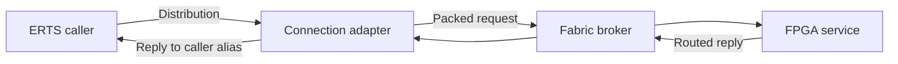

# Virtual FPGA nodes

One host BEAM can expose several virtual FPGA nodes. Their advertised PIDs are real external Erlang PIDs, not host forwarding processes. Services can use packed device brokers or incarnation endpoints supplied by a managed domain. Ordinary ERTS nodes communicate unchanged; the adapter converts supported distribution messages into device frames.

## Messages and supported operations



Standalone services accept generated `gen_server` calls/casts. [Scheduled actors](actor-pids.md) accept casts; synchronous calls return `{error, unsupported_call}`. Effects follow topology routes and are not replies to the latest sender.

The endpoint accepts authenticated protocol-v6 connections, one per peer name, with monitor/alias support. It handles PID/name sends, monitors/demonitors, alias replies and `net_adm:ping`. Absent identities report `noproc`. It acknowledges unlink requests but establishes no links. RPC, remote spawn, link/exit propagation, sequential tracing and outgoing connections are unsupported. Unsupported signals or malformed actor messages close that peer connection.

TCP is the default. `-proto_dist hls_local` uses an in-process controller for locally hosted virtual nodes while retaining TCP for ordinary peers and remote callers. Both carriers serialize ETF; the local carrier removes socket transfers, not serialization. There is one adapter per connection, without a per-actor forwarding mailbox.

## Lifetimes and recovery

Actor PIDs belong to a node incarnation and survive caller death or peer reconnect. Restarting the virtual node creates a new EPMD incarnation; stale PIDs cannot address it. Restart does not reset device state. For legacy packed services, monitors reflect virtual identity/connection availability, not independent terminal hardware failure. Managed domains instead propagate the actual local incarnation endpoint's terminal reason, as described below.

A connection owns its pending calls, monitors and return routes. A caller timeout deactivates its reply alias but does not cancel accepted device work or release its transaction slot. The eventual response releases the slot; ERTS discards replies to inactive aliases.

Disconnect retires the connection's routes. Delayed replies to them are discarded; accepted operations are never replayed. Each connection using physical brokers consumes two fresh source addresses, including reservations from failed partial attachments. Managed-only connections reserve no broker addresses. Addresses are never reused within the brokers' lifetime; exhaustion rejects attachment.

Connection failure leaves the node and other peers alive. Losing a broker or a significant node service stops the whole node without automatic reactivation. Physical brokers remain deployment-owned. Replacing them requires a drain/reset boundary covering old device output and confirmed descriptor release: a new EPMD creation alone cannot fence old hardware completions. Resetting hardware beneath an active adapter is unsupported.

## Managed domain incarnations

Enroll an already-ready `hls_domain` owned by a local deployment process:

```erlang
{ok, Node} = hls_node:start_link(DeviceName, #{}, [
    #{name => workers, domain => #{owner => DomainOwner, id => workers}}
], #{queue_limit => 32}),
#{workers := #{domain := Handle, actors := Actors}} = hls_node:services(Node).
```

The returned actor PIDs accept the endpoints' ordinary `gen_server` calls and casts from another ERTS node. Calls and casts use the shared `{'$hls_submit', Token, Mode, Message}` endpoint request. The endpoint separately reports `{hls_admitted, Endpoint, Token}` before its eventual reply or termination, so accepting a call does not require completing it. The acknowledged-cast helper `hls_statem:admit_cast/2` remains available to callers. This interface is implemented by `hls_statem` and must be implemented by a hardware-domain endpoint adapter; a raw legacy broker service is not such an adapter. The domain owner and lifecycle backend remain responsible for readiness, physical fencing, reset completion and application setup. Node enrollment never resets or starts actors.

Each virtual PID identifies one actor in one domain incarnation. An endpoint's actual `DOWN` completes its existing remote monitors with the same reason and leaves unrelated domains and the distribution connection alive. Pending calls fail through those ERTS monitors, rather than returning an ordinary error value. Replies sent before the endpoint died retain their ordering before its monitor exits. The adapter issues requests directly; there is no intermediary reply-forwarding process that could reorder a late reply after death. A terminal actor exit retires the PID permanently. A host proxy's `noconnection` instead leaves that identity disconnected: current and newly established monitors report `noconnection`, ordinary sends are discarded, and accepted work may still have happened. This also applies to a new peer connecting during the outage.

After an explicitly requested domain replacement becomes ready, call `hls_node:publish_domain(Node, workers)`. It rejects a non-ready domain, a changed actor set, regressing incarnation, or any still-live old endpoint. A newer incarnation receives fresh monotonically allocated virtual IDs within the same EPMD creation; exhaustion rejects instead of wrapping. Connected adapters first consume actual old endpoint `DOWN` signals, then install the new PIDs. The call completes after those adapters acknowledge publication. Exact duplicate publication returns the same handles. Old PIDs never redirect to the replacement, and no pending call or cast is replayed. A caller timeout leaves publication uncertain; inspect `services/1` or repeat publication rather than inferring cancellation.

If the hardware actor survived a host backend loss, first reconcile the existing owner with `hls_domain:reattach(DomainOwner, Handle, FreshBackend)`. Then call `hls_node:reattach_domain(Node, workers)`. The owner must attest the same ready incarnation and actor set; every old proxy must have died with `noconnection`. Reattachment replaces those proxies while retaining the existing virtual PIDs and node creation. Old monitor references stay terminal, and interrupted calls and casts are not replayed. Callers establish fresh monitors and decide whether to issue new application work. A different incarnation requires `publish_domain/2` and new PIDs instead. A genuine terminal actor exit cannot be reattached. An explicitly killed host proxy has already exposed `killed`, rather than `noconnection`, to its observers; that identity also stays terminal even though hardware may survive. Recovery then needs a fresh virtual-node identity or an explicit domain replacement policy. Proxy death does not by itself authorize resetting the device. A reattachment candidate already gone before a peer installs its monitor is instead an unsuccessful connection attempt: it stays `noconnection`, and a later explicit reattachment may try a fresh proxy.

This follows ERTS's distinction between losing a connection and losing a process, within the adapter's supported operations. It does not add remote links, exit propagation or transparent continuation of calls. The virtual node's manager must survive to retain its PID inventory; restarting that manager still changes the EPMD incarnation. A raw-cast rejection which withdrew a particular peer's binding remains withdrawn for that peer even after domain reattachment.

One publication or reattachment is admitted at a time. Peer attachment during publication, or while a dead proxy's exit reason is still being consumed, is rejected and can reconnect afterward. Node management is a separate local API; it does not travel through the application packet parser, and partial application packets cannot obstruct the domain owner's fencing or reset commands. Publication itself waits for each existing adapter to process its queued retirement signals. Killing an adapter is connection loss, not a fabricated actor failure.

Managed-only nodes use an empty broker map. Mixed managed/legacy services retain the existing distinct application/debug broker requirement. A managed domain owner is fixed in its declaration; owner restart is a deployment reconciliation problem, not an automatic rebinding operation. The exclusive sealed source-partition mode is unchanged and cannot be mixed with managed services. This adapter adds no recovery guarantee to the legacy source bridge's packed framing or credits; a hardware backend must establish its own epoch and completion boundaries before publishing ready endpoints.

## Admission and ordering

Each physical endpoint/connection has 255 application call slots or 256 debug slots. Application casts use ID 255 and need no reply slot. Logical actors sharing an endpoint share an ordered queue and one outstanding host write; blocked work can delay later actors. Separate endpoints still share transport and connection admission.

Both legacy wire channels and managed endpoints use one request ledger. Work awaiting admission consumes connection input credit; admitted managed calls retain completion ownership bounded separately by `queue_limit` per actor. Full call capacity returns busy without blocking a later release cast. At the connection waiting limit, distribution intake pauses and ordinary ERTS flow control applies, including sender suspension at `+zdbbl`. Replies and capacity notifications continue to drain. These bounds do not bound remote mailboxes, monitors or all distribution/socket buffers; a flood of unadmitted work on one ordered input can still delay later traffic.

A managed cast explicitly refused as busy before admission stays at its actor's queue head and waits for `'$hls_capacity'` to report room before another admission attempt. It never retries an accepted or uncertain operation. An irrecoverable unacknowledged-cast failure withdraws only that peer's target binding with `noconnection`; other actors and the connection remain usable. This does not assert source death or cancel previously accepted work. Publication still requires actual old endpoint termination.

Only legacy `tx_limit`/`route_tx_limit` rejections that prove non-transmission permit retries, at the same queue head after five milliseconds. Ambiguous failures close the connection. Broker writes have no deadline; caller timeouts retain normal ERTS semantics.

Application and debug use separate physical streams but share the peer connection, so saturation may delay later debug/control messages. TCP receive-inactivity checks pause when intake is deliberately blocked; failed socket writes can still close the connection. Local liveness uses the host's `net_ticktime`; `tick_ms` applies to TCP peers.

## Configuration and inspection

`hls_fabric_sup:start_node/4` attaches existing brokers. `hls_node:services/1` returns service handles; `info/1` reports incarnation, listener and connections. `hls_fabric:client_info/1` reports host queued/pending work and ignored replies. Device counters/traces use the debug PID; actor observations use a verified catalog. Native `process_info` is not a remote-device query.

| Option | Default | Meaning |
| --- | --- | --- |
| `ip`, `port` | Advertised host's IPv4 address, `0` | Listener interface and selected port |
| `epmd_port` | `4369` | Local EPMD endpoint |
| `max_connections` | `8` | Active authenticated peers |
| `source_range` | `{1,65535}` | Fresh return addresses; two per connection |
| `queue_limit` | `32` | Shared waiting-admission threshold; also the managed unfinished-call bound per actor |
| `tick_ms` | `15000` | TCP tick interval; inactivity limit is four intervals; match peer `net_ticktime` |

Packets are capped at 1 MiB; handshake reads and socket writes time out after five seconds. Broker bounds are configured separately.

## Hardware boundary

The service must preserve reply ownership across connections. [Return contexts](return-contexts.md) specify slot lifetime, reply remapping and reset obligations. Implementation structure and follow-ups live in [maintainer notes](../yap/node-implementation.md).
