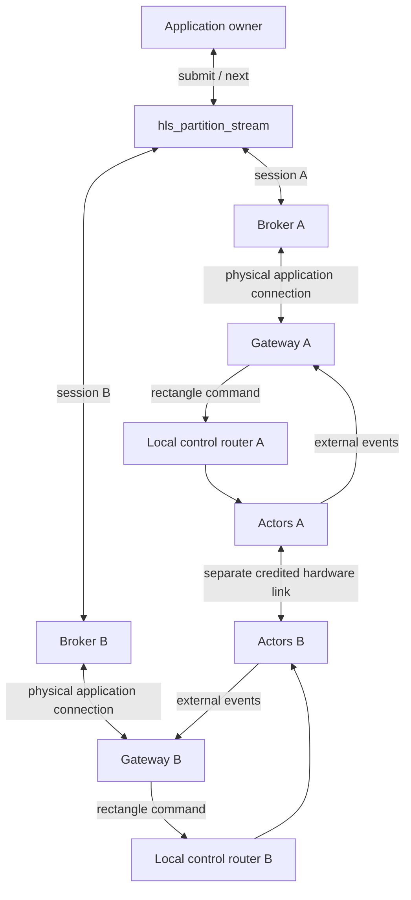

# Partition application streams

One BEAM process can submit rectangle commands to a partition and consume typed events from its devices through one `hls_partition_stream` client PID. That client owns **one logical session on each device’s physical application broker**. Each FPGA has its own application gateway. Debug connections and the FPGA–FPGA link remain separate.



The client API addresses geometry explicitly; it does not expose these actors through the repository's virtual distribution-node/PID interface.

## Command and event flow

A command is `{Ingress, Target, {X0, Y0, X1, Y1}, Record}`, with inclusive global bounds. Delivery has three stages:

1. **BEAM selects devices.** It validates the record and bounds, finds actors belonging to `Target` whose global points lie inside the rectangle, and sends one packet to each device owning a match. The packet keeps the original rectangle; coordinates are neither clipped nor rebased. A command can select zero, one or several devices. Placement need not form contiguous rectangles.
2. **Each gateway reconstructs the command.** `hls_partition_io.x` checks attachment and packet framing, then emits a complete `SpatialFrame` to the device graph. It does not choose devices or actors.
3. **Each local control router selects actors.** It tests target membership and rectangle containment for its local actors and sends each match the record. Each actor has one ordered control lane across targets, so a query cannot overtake an earlier update.

For example, if device A owns rows 0–1 and B owns rows 2–3, a rectangle covering rows 1–2 goes to both devices unchanged. A delivers only to its matching row-1 actors; B delivers only to its matching row-2 actors.

Events return through the gateway and the same physical application connection. `next/2` identifies the producing device and named external output. Ordinary actor messages crossing the partition use the FPGA–FPGA link directly. In the D3 memory application, corrections are deliberately external events: the host reducer consumes them and submits point-addressed Pauli updates through this command path.

## Attach and use

```erlang
Deployment = hls_partition_wire:deployment(Partition),
{ok, Stream} = hls_partition_stream:start_link(Deployment, Brokers, #{}),
{ok, DeviceCount} = hls_partition_stream:submit(Stream,
    {Ingress, Target, {X0, Y0, X1, Y1}, Record}),
{ok, Device, External, Event} = hls_partition_stream:next(Stream, 1000).
```

`Brokers` maps each device ID to a distinct existing `hls_fabric` application broker. The caller owns the client. Each device must have one rectangle ingress and at least one external output; actor payloads are limited to 96 bits.

Attachment compares each gateway's SHA-256 deployment identity before returning. The identity covers placement, startup values and wire bindings; its acknowledgment precedes external events. It detects deployment mismatches, not corruption or malicious peers, and does not replace debug-manifest verification.

`submit/2` validates and admits the whole selected-device batch to bounded host queues, or returns `{error, busy}` without sending any of it. Commands retain per-device order through admission retries and stalls. Admission is atomic; cross-device delivery is not. Neither admission nor a completed host write acknowledges execution: use an application reply as the completion fence.

`next/2` returns one decoded event or `timeout`; a timeout cannot consume a later event. Receive credit remains held until delivery to the owner, propagating slow consumption back through bounded broker queues. Each external output preserves source order; different outputs/devices have no global order. `info/1` reports host queue and delivery statistics without querying hardware.

The default limit is 128 queued/in-progress frames across the selected devices. `write_timeout` defaults to 10000 ms from admission. Only broker rejections guaranteeing non-transmission are retried, preserving the original deadline. Event consumption and inspection remain available while writes stall.

## Explicit activation

An application with setup-dependent startup can use `hls_partition_io::OrderedBoundary` and declare `activation => explicit_start` in each matching device binding. The application binding must include this protocol choice in its deployment identity. The ordinary generated wrapper still uses automatic activation; changing its host map alone does not add an activation barrier to that hardware.

Submit setup rectangles first, then `hls_partition_stream:submit(Stream, start)`. Start is single-use per connection and targets every bound device; all devices must support explicit activation. A busy rejection leaves start available for retry. The gateway carries setup and start on one ordered command channel. `priv/rtl/hls_partition_activation.sv` splits that channel at the application boundary; the application's `start_ready` must assert only after earlier setup has drained. The bridge acknowledges the actual start handshake, and the gateway returns `{ok, Device, application, {started}}` through the credited event stream. Host admission or write completion is not activation. Each device starts independently; this is not a simultaneous cross-device barrier.

`info/1` reports each binding as `automatic`, `configured`, `start_pending` or `running`; only a canonical started reply marks running. Duplicate requests are rejected before transmission. Unsolicited, duplicate or malformed replies retire the connection. Coordinated reset must cover the gateway, activation bridge, application and transport before reattachment; it cancels partially received commands and pending starts/replies.

## Module responsibilities

“Wire” and “stream” describe different layers of this same connection:

| Component | Responsibility |
| --- | --- |
| `hls_partition_ingress` | Pure geometry validation and device selection. |
| `hls_partition_wire` | Pure deployment bindings, packet codecs and generated wrapper; no process or I/O. |
| `hls_partition_stream` | Stateful BEAM client: sessions, attachment, ordered bounded queues, timeouts and event delivery. |
| `hls_partition_io.x` | Static hardware gateway: packet checks/assembly and fair event serialization. |
| Generated `ControlRouter` | Local actor selection from the rectangle and target. |
| `hls_credit_link` | Separate FPGA–FPGA actor transport. |

## Failure and replacement

Losing the owner, a broker or a session ends the whole client connection. Malformed events and ambiguous write failures do the same. Commands are never replayed after uncertain delivery. `stop/1` retires logical routes and pending host work while leaving deployment-owned brokers open.

Attachment is single-use until reset. A matching deployment identity is not an activation generation or proof that old device work has drained. The deployment owner must coordinate replacement:

1. Save the physical brokers' `io.lease` references, retire all application/debug clients, then stop their brokers. Broker death alone does not confirm descriptor closure.
2. Isolate the old transport and hold all graphs, gateways and links in reset. The physical adapter must complete or abort blocked raw I/O so its workers can close their descriptors.
3. Require `hls_fabric:await_closed/2` to succeed for every saved lease. Clear all transport storage and framing state before reopening; a timeout leaves the deployment unavailable.
4. Release the coordinated reset, open fresh brokers and verify their identities. Start a fresh application reducer; never replay the abandoned run's commands or accept its replies.

The client does not perform these physical operations. The simulation adapter qualifies this sequence with interrupted commands and unread replies; PS–PL DMA still needs its own reset implementation and conformance checks.

Whole-partition restart is a restriction of the current backend, not a scalable recovery policy. Independent link or actor recovery is unsupported; ending a host session does not establish that hardware work stopped.

## Current wire bindings

Endpoints are 16-bit addresses within a routed application connection, separate from actor identities, geometry targets and hardware-link lanes. The current allocation is fixed:

| Binding | Value | Meaning |
| --- | --- | --- |
| `control` | `7` on each device | That device's application gateway: attachment and rectangle commands. |
| External event source | `8` upward per device | One endpoint for each named external output. |
| `host` | `1` through the device count | Host return addresses distinguishing device bindings. |

The choice of 7 is arbitrary; it does not encode a device, reserve endpoints 0–6 or designate an actor. Callers use the deployment map rather than these numbers. Commands travel on `{Host, Control}` routes; events return on `{ExternalEndpoint, Host}` routes.

All beats are complete little-endian 32-bit words with exact packet termination:

| Packet | Opcode | Payload |
| --- | ---: | --- |
| Attach | `1` | Eight identity words |
| Attach acknowledgment | `0x81` | The same identity |
| Rectangle command | `2` | Two coordinate words, target word, actor header, then actor payload |
| Start (explicit activation only) | `3` | One zero word |
| Started acknowledgment | `0x83` | One zero word, after application activation |
| Protocol fault | `0xff` | Code `1`; control remains disabled until reset |

Coordinates are `x0,y0,x1,y1` as successive little-endian `u16`s. The target occupies the low two bits of its word; other bits are zero. The actor header carries its selector and payload-word count. Transaction IDs and flags are zero. External events retain their generated actor header/payload.

Invalid routing, attachment or framing drains through the actual final beat, reports one fault and disables further control until reset. Unterminated input requires transport reset. A physical adapter must enforce full-word byte enables and lossless, ordered delivery.
