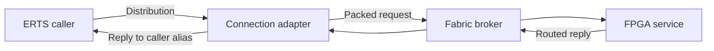

# Virtual FPGA nodes

One host BEAM can expose several virtual FPGA nodes. Their application/debug PIDs are real external Erlang PIDs, not host processes. Ordinary ERTS nodes communicate unchanged; the adapter converts supported distribution messages into device frames.

## Messages and supported operations

Standalone services accept generated `gen_server` calls/casts. [Scheduled actors](actor-pids.md) accept casts; synchronous calls return `{error, unsupported_call}`. Effects follow topology routes and are not replies to the latest sender.

The endpoint accepts authenticated protocol-v6 connections, one per peer name, with monitor/alias support. It handles PID/name sends, monitors/demonitors, alias replies and `net_adm:ping`. Absent identities report `noproc`. It acknowledges unlink requests but establishes no links. RPC, remote spawn, link/exit propagation, sequential tracing and outgoing connections are unsupported. Unsupported signals or malformed actor messages close that peer connection.

TCP is the default. `-proto_dist hls_local` uses an in-process controller for locally hosted virtual nodes while retaining TCP for ordinary peers and remote callers. Both carriers serialize ETF; the local carrier removes socket transfers, not serialization. There is one adapter per connection, without a per-actor forwarding mailbox.

## Lifetimes and recovery

Actor PIDs belong to a node activation and survive caller death or peer reconnect. Restarting the virtual node creates a new EPMD incarnation; stale PIDs cannot address it. Restart does not reset device state. Monitors currently reflect virtual identity/connection availability, not independent terminal hardware failure.

A connection owns its pending calls, monitors and return routes. A caller timeout deactivates its reply alias but does not cancel accepted device work or release its transaction slot. The eventual response releases the slot; ERTS discards replies to inactive aliases.

Disconnect retires the connection's routes. Delayed replies to them are discarded; accepted operations are never replayed. Each new connection consumes two fresh source addresses, including reservations from failed partial attachments. Addresses are never reused within the brokers' lifetime; exhaustion rejects attachment.

Connection failure leaves the node and other peers alive. Losing a broker or a significant node service stops the whole node without automatic reactivation. Physical brokers remain deployment-owned. Replacing them requires a drain/reset boundary covering old device output and confirmed descriptor release: a new EPMD creation alone cannot fence old hardware completions. Resetting hardware beneath an active adapter is unsupported.

## Admission and ordering

Each physical endpoint/connection has 255 application call slots or 256 debug slots. Application casts use ID 255 and need no reply slot. Logical actors sharing an endpoint share an ordered queue and one outstanding host write; blocked work can delay later actors. Separate endpoints still share transport and connection admission.

At `queue_limit`, the adapter pauses distribution intake; ordinary ERTS flow control applies, including sender suspension at `+zdbbl`. Receipts and replies continue to drain. Admission retries can temporarily exceed the waiting threshold by one operation per destination. This limit does not bound remote mailboxes, monitors or all distribution/socket buffers.

Only `tx_limit`/`route_tx_limit` rejections that prove non-transmission permit retries, at the same queue head after five milliseconds. Ambiguous failures close the connection. Broker writes have no deadline; caller timeouts retain normal ERTS semantics.

Application and debug use separate physical streams but share the peer connection, so saturation may delay later debug/control messages. TCP receive-inactivity checks pause when intake is deliberately blocked; failed socket writes can still close the connection. Local liveness uses the host's `net_ticktime`; `tick_ms` applies to TCP peers.

## Configuration and inspection

`hls_fabric_sup:start_node/4` attaches existing brokers. `hls_node:services/1` returns service handles; `info/1` reports incarnation, listener and connections. `hls_fabric:client_info/1` reports host queued/pending work and ignored replies. Device counters/traces use the debug PID; actor observations use a verified catalog. Native `process_info` is not a remote-device query.

| Option | Default | Meaning |
| --- | --- | --- |
| `ip`, `port` | Advertised host's IPv4 address, `0` | Listener interface and selected port |
| `epmd_port` | `4369` | Local EPMD endpoint |
| `max_connections` | `8` | Active authenticated peers |
| `source_range` | `{1,65535}` | Fresh return addresses; two per connection |
| `queue_limit` | `32` | Waiting-operation threshold |
| `tick_ms` | `15000` | TCP tick interval; inactivity limit is four intervals; match peer `net_ticktime` |

Packets are capped at 1 MiB; handshake reads and socket writes time out after five seconds. Broker bounds are configured separately.

## Hardware boundary

The service must preserve reply ownership across connections. [Return contexts](return-contexts.md) specify slot lifetime, reply remapping and reset obligations. Implementation structure and follow-ups live in [maintainer notes](../yap/node-implementation.md).
