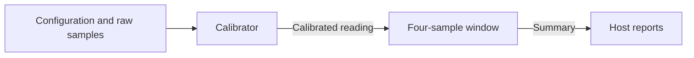

# Windowed telemetry project

This example turns signed sensor samples into reports through two communicating actors. It is a small complete compiler project: message definitions, application logic, a logical graph, a CPU host, hardware-source packaging and a generated-RTL witness. It uses only `erl_hls` and `hls_runtime`; the decoder applications and `hls_fabric` are not dependencies.

## Read the project

| File | Responsibility |
| --- | --- |
| `telemetry.hrl` | Shared typed configuration, raw-sample, calibrated-reading and summary records; their numeric message selectors agree at both actors. |
| `telemetry_calibrator.erl` | Wait for configuration, apply gain/offset, clamp to signed16, and publish a reading with a clipping flag. |
| `telemetry_window.erl` | Accumulate four readings, publish their sum/extrema/clipping count, and clear the completed window. |
| `telemetry_topology.erl` | Declare actor instances, accepted command messages, routes and the report boundary. |
| `telemetry.erl` | Own the CPU actors and finite host pacing; separately package the connected hardware build. |



The calibrator widens `raw * gain + offset` to signed32 before saturating to signed16. Those operand ranges cannot overflow signed32. The window sum of four signed16 readings also fits signed32. Its three-bit counters represent every count from zero through four. Sequence fields are caller labels, not counters maintained by the application; a report keeps the fourth reading's label. Values at the saturation limits are not counted as clipped unless clamping changed them.

Before the first configuration, raw samples postpone in the calibrator's four-slot mailbox. Reserve a slot for configuration: sending four early samples can prevent that configuration from entering the hardware actor. The host helper permits at most three. Later configurations affect samples selected after them; they do not flush a partial window, so a window can include two calibration settings. There is one command sender, and its order is preserved. Neither actor assumes a global ordering between independent senders.

Each actor separates computation from publication with a phase transition. Entry emits the saved reading or summary; a declared private `advance` event then returns to the consuming phase. The event runs after entry commits and before another mailbox selection. It consumes no mailbox slot, avoiding a cycle in which an actor needs a free mailbox slot to release a full mailbox. An entry may hand its effect to bounded downstream transport before the final host receives it; backpressure retains that effect until delivery.

## Run on Erlang

From the repository root, with OTP 28 and rebar3:

```sh
rebar3 compile
erl -noshell -pa _build/default/lib/*/ebin \
  -eval 'io:format("~p~n", [telemetry:run(telemetry:example_commands())]), halt().'
```

The two reports are:

```erlang
[{summary,3,-18,-32768,32767,2},
 {summary,7,32500,0,32100,0}]
```

`telemetry:run/1` starts real `hls_statem` processes, connects the calibrator to the window actor and routes reports back to an isolated host worker. It paces complete windows and stops both actors on completion. The CPU scheduler has a BEAM mailbox ahead of its bounded queue; this run does not measure hardware backpressure or throughput.

The helper accepts the records in `telemetry.hrl` (or their Erlang tuple representations). For example, send `{raw,0,10}` before `{configure,0,2}` to see postponement, then supply three more samples to complete the first window. The helper requires complete windows and fails on missing configuration or invalid field values. The hardware itself may remain alive with a partial window indefinitely; it emits nothing for that incomplete window.

## Build hardware sources and RTL

```sh
rebar3 release
erl -noshell -pa _build/default/lib/*/ebin \
  -eval 'telemetry:write_bundle(hd(init:get_plain_arguments())), halt().' \
  -extra /tmp/telemetry-build
_build/default/rel/erl_hls/bin/compile-source-build \
  /path/to/xls /tmp/telemetry-build
```

Choose a fresh output directory. `write_bundle/1` first normalizes `telemetry_topology`, asks `xls_topology_dslx:artifact_requirements/2` for each actor's compilation requirements, lowers the actor sources through `xls_parse:to_artifact/2`, and emits the connected graph through `xls_topology_dslx:emit/2`. It retains actor failure-codebook sidecars, snapshots compiler support and freezes the standard `source-build.json`. This is the same packaging API used by other toolchain clients. `hlsc emit` currently packages individual actors; this project's short build function supplies the composition step.

The optional external driver then converts DSLX to XLS IR, optimizes it and generates `telemetry.v`. The immutable result is published through `/tmp/telemetry-build/compiled`; its `files.f`, logs and `compiled.json` describe the exact products. The bundle can move before compilation. The selected schedule is two stages with a unit-delay model, not a physical clock-frequency estimate. No FPGA synthesis, placement or routing is performed.

The generated `telemetry_top` module has clock/reset plus one ready/valid command input and one ready/valid report output. Its command value is the XLS flattened `SpatialFrame`: a 64-bit rectangle, two-bit target selector and 128-bit ordinary frame, totaling 194 bits. Target zero and rectangle `[0,0,0,0]` address the calibrator. The ordinary frame has a 32-bit header and three 32-bit payload words; the 83-bit summary fits in that capacity. This native XLS port layout is **not** the canonical serialized byte stream of a board protocol. The regression fixture explicitly packs this boundary using the generated record codecs and selector metadata. A board deployment must add a matching clock/reset and transport wrapper; this project does not imply a live FPGA deployment.

## Check and extend it

```sh
rebar3 eunit --module=telemetry_example_tests
python3 tools/run_regression.py /path/to/xls /tmp/telemetry-check --cases telemetry
```

The local hardware regression invokes `telemetry:write_bundle/1` and the standard external driver, then checks generated RTL structure and simulates the public ports. A separate arithmetic oracle checks the actual CPU actors before their transcript becomes the RTL expectation. The finite witness covers signed extrema and clipping, configuration changes within a window, early-sample postponement, invalid ingress envelopes, input/output stalls, reset during a partial window and reset with a report held. It is a simulation witness, not a universal equivalence or throughput proof. It adds no separate Actions job.

To experiment, change the gain/saturation policy in the calibrator, extend the summary record with another statistic, or add a new actor and route in the topology. Update the independent oracle when application semantics change. A wider message must still fit the selected frame layout; a larger window needs correspondingly wider counters and a justified accumulator range. Keep device transport and scheduling policy outside the actor callbacks.
